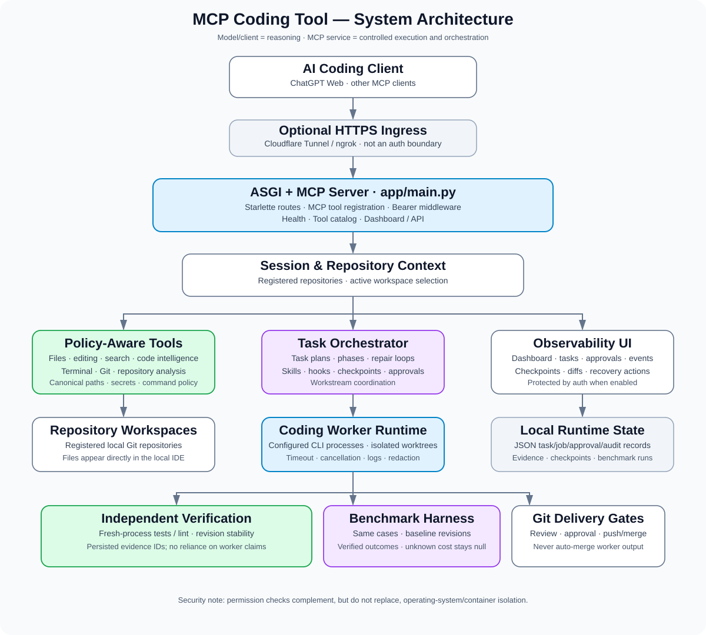
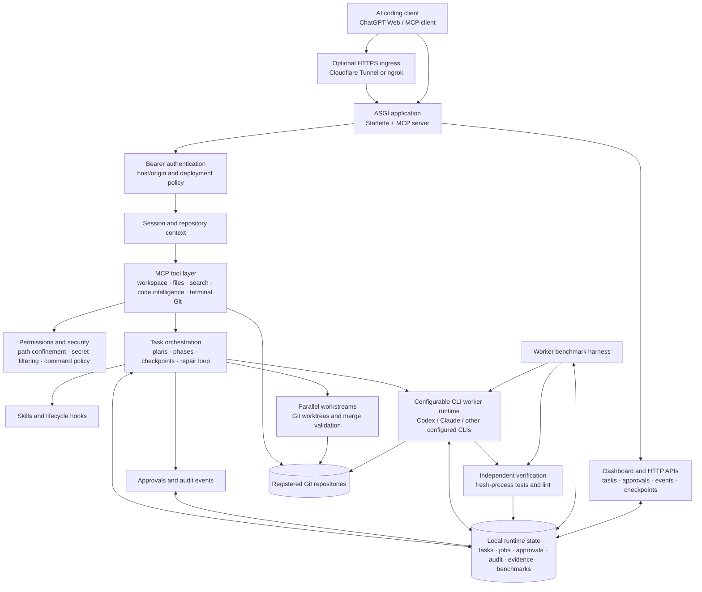

# MCP Coding Tool

A standalone **Model Context Protocol (MCP) server** that gives a connected AI coding client controlled access to registered repositories. It combines repository/file/Git tools with task tracking, reusable skills, approvals, parallel workstreams, configurable CLI coding workers, independent verification, and benchmark reporting.

The server is the **execution and control layer**; the connected model/client is normally the reasoning and planning layer. In the ChatGPT Web workflow, the server does not create additional ChatGPT sessions. Optional coding workers are configured CLI processes (for example, Codex CLI or Claude Code) and run through the worker runtime.

> **Status and accuracy:** This README describes the repository structure and implementation paths inspected for this revision. Configured CLI workers, Docker sandboxing, tunnel connectivity, and external-provider integrations require their own runtime prerequisites and configuration. A feature documented here does not mean the external executable is installed or a live deployment has been tested.

## Contents

- [What it does](#what-it-does)
- [Architecture](#architecture)
- [Capabilities](#capabilities)
- [Repository layout](#repository-layout)
- [Requirements](#requirements)
- [Quick start on Windows](#quick-start-on-windows)
- [Configuration](#configuration)
- [Run locally](#run-locally)
- [Connect a client](#connect-a-client)
- [Worker runtime](#worker-runtime)
- [Task lifecycle and verification](#task-lifecycle-and-verification)
- [Dashboard and HTTP endpoints](#dashboard-and-http-endpoints)
- [MCP tool families](#mcp-tool-families)
- [Security model](#security-model)
- [Testing and quality checks](#testing-and-quality-checks)
- [Docker deployment](#docker-deployment)
- [Troubleshooting](#troubleshooting)
- [Documentation](#documentation)
- [Known boundaries](#known-boundaries)

## What it does

- Registers and switches between independent local repositories.
- Inspects source code, symbols, function/class definitions, references, and project structure.
- Reads, writes, patches, copies, moves, backs up, restores, and previews diffs for files within the selected workspace, subject to permission and path policies.
- Runs configured development commands and tests with timeouts and output limits.
- Inspects and manages Git branches, commits, diffs, worktrees, and policy-gated remote operations.
- Routes coding tasks to reusable skills and records plans, steps, test runs, repair attempts, issues, and verification state.
- Requests and records approvals for sensitive operations.
- Creates isolated parallel workstreams and validates/coordinates their integration.
- Launches configured CLI coding workers in independent Git worktrees, tracks jobs, captures outputs/diffs, and supports cancellation.
- Runs independent verification and benchmark tasks against repeatable repository baselines.
- Provides health/tool endpoints and a local task/approval/checkpoint dashboard.

## Architecture

### Architecture diagram



The following Mermaid diagram is kept in the README so GitHub and Markdown tools that support Mermaid can render the same topology.



### Runtime layers

1. **Client and ingress:** ChatGPT Web or another MCP client connects over the configured MCP HTTP transport. Cloudflare Tunnel/ngrok are optional for remote access; the tunnel is not an authorization boundary.
2. **Application layer:** `app/main.py` wires the MCP server, custom HTTP routes, authentication middleware, dashboard, and registered tools.
3. **Session and repository layer:** a repository registry tracks allowed workspaces; session context determines which repository tools operate on.
4. **Policy-aware tool layer:** filesystem, editing, code search/intelligence, terminal, repository analysis, and Git operations use repository-boundary and permission checks.
5. **Task-control layer:** tasks and phases are persisted locally; the orchestrator supports task plans, repair loops, checkpoints, approvals, workstreams, and verification gates.
6. **Worker and evaluation layer:** configured CLI worker processes use Git worktrees; independent checks run separately from worker claims; benchmark records keep baseline revisions and results.
7. **Runtime storage:** the current implementation uses files under `runtime/` for task state and other local records. This is local application state, not a multi-node database.
8. **IDE feedback:** normal file writes are directly visible to an IDE such as VS Code because the selected repository is the real on-disk workspace.

## Capabilities

| Area | What is implemented in the repository |
|---|---|
| Repository management | List/select/register/remove repositories and clone allowlisted GitHub repositories, subject to configuration |
| Filesystem | Listing, reading, writing, directory creation, delete/move/copy, backup/restore, diff preview, secret-pattern protections |
| Code intelligence | Text search, symbol/reference discovery, function/class listings, structural inspection |
| Terminal | Configured developer command execution, test helper, dependency installation, timeout/output limits and failure diagnostics |
| Git | Status/diff/log/show/branches/changed files, staging/commit/branch operations, worktrees, policy-gated fetch/pull/push and recovery tools |
| Skills and hooks | Skill discovery/loading/reload, automatic workflow preparation, lifecycle hook listing/execution |
| Task orchestration | Persistent JSON-backed task plans, step/test/issue tracking, bounded repair, task phases and checkpoint helpers |
| Approvals | Expiring approval requests, explicit decisions, matching operation/target checks and audit logging |
| Workstreams | Isolated Git worktrees, validation and approval-aware merge coordination |
| CLI workers | Configurable argv-based worker CLI subprocesses, separate worktrees, status/results/logs, timeout/cancellation, redaction and interrupted-job marking |
| Independent verification | Fresh subprocess checks, revision/working-tree stability tracking and persisted evidence IDs |
| Benchmarks | Repeatable worker cases requiring a clean baseline, isolated worktrees, verification, durations and unknown-cost reporting |
| Web routes | Health and categorized tool listing, task/approval/event/checkpoint APIs and dashboard |
| Deployment | Local server/tunnel scripts and Docker/container configuration |

## Repository layout

```text
MCP/
├── app/
│   ├── main.py                 # MCP registration, ASGI routes, dashboard integration
│   ├── config.py               # Environment-backed settings and safety defaults
│   ├── auth/auth.py            # Bearer-token middleware
│   ├── core/
│   │   ├── audit.py            # Structured local audit events
│   │   ├── approvals.py        # Approval queue and authorization matching
│   │   ├── benchmark.py        # Coding benchmark records/reporting
│   │   ├── execution_profile.py# Autonomy and workflow configuration
│   │   ├── github_workspace.py # Allowlisted remote workspace support
│   │   ├── hooks.py            # Lifecycle hooks
│   │   ├── orchestrator.py     # Autonomous task workflow/checkpoints
│   │   ├── permissions.py      # Permission profile and policy engine
│   │   ├── repository.py       # Repository registry/resolution
│   │   ├── security.py         # Path/secret and security helpers
│   │   ├── session.py          # Active repository/session selection
│   │   ├── skills.py           # Skill discovery/loading
│   │   ├── task_state.py       # Persistent task state and phases
│   │   ├── verification.py     # Independent verification evidence
│   │   ├── worker_benchmark.py # Worker benchmark orchestration
│   │   ├── worker_runtime.py   # CLI workers, worktrees, cancellation
│   │   └── workstreams.py      # Worktree-backed parallel work
│   └── tools/                  # MCP tool wrappers grouped by responsibility
├── config/
│   ├── repositories.json       # Local repository registry (machine-specific)
│   └── repositories.example.json
├── docs/                       # Architecture, security, setup, PRD and operations
├── runtime/                    # Generated task, worker, audit and evidence state
├── scripts/                    # Doctor, startup, tunnel, connectivity and benchmark scripts
├── skills/                     # Reusable workflow instructions
├── tests/
│   ├── unit/
│   ├── integration/
│   ├── security/
│   └── e2e/
├── Dockerfile
├── docker-compose.yml
├── env.example
├── requirements.txt
└── pyproject.toml
```

> Do not commit private tokens or machine-specific credentials. Check `.gitignore` before adding generated runtime artifacts or local configuration.

## Requirements

- Python 3.10 or newer; Python 3.11 is used by the Dockerfile.
- Git installed and available on PATH.
- Windows PowerShell for the documented Windows commands; most application code is Python and uses pathlib/subprocess, but scripts and worker/container behavior can be platform-specific.
- Optional: Cloudflare Tunnel (`cloudflared`) or ngrok for HTTPS ingress.
- Optional: Docker/Podman-compatible runtime and a worker image if using Docker-sandboxed CLI workers.
- Optional: the CLI programs you configure as coding workers, and their own authentication/configuration.
- Optional development dependencies for Ruff and test tooling.

## Quick start on Windows

Run commands from the MCP repository root.

### 1. Create and activate a virtual environment

```powershell
python -m venv .venv
.\.venv\Scripts\Activate.ps1
python -m pip install --upgrade pip
pip install -e ".[dev]"
```

Alternatively, install runtime dependencies only with `pip install -r requirements.txt`.

### 2. Prepare environment configuration

```powershell
Copy-Item env.example .env
```

Edit `.env` for your machine. Keep it private and never commit it. Local-only development can use loopback with authentication disabled. Any remotely exposed deployment must use authentication and transport restrictions; see [Security](docs/SECURITY.md).

### 3. Configure repositories

Edit `config/repositories.json` based on `config/repositories.example.json`. Use absolute paths and register only repositories you intend the server to control.

Example:

```json
{
  "repositories": {
    "my-app": {
      "path": "C:/Development/my-app",
      "description": "My application repository",
      "enabled": true
    }
  }
}
```

The checked-in `repositories.json` is machine-specific runtime configuration; inspect it locally and do not publish private paths if they are sensitive.

### 4. Run diagnostics

```powershell
python scripts/doctor.py
```

The doctor checks Python, core dependencies, port availability, repository configuration, and optional tunnel tools. A missing tunnel binary is only a blocker if you want tunnel-based access.

### 5. Start the local server

```powershell
python scripts/start.py
```

Default local base URL is `http://127.0.0.1:8766`.

Useful endpoints:
- Health: `http://127.0.0.1:8766/health`
- Registered tool categories: `http://127.0.0.1:8766/tools`
- MCP Streamable HTTP: `http://127.0.0.1:8766/mcp`
- MCP SSE compatibility endpoint: `http://127.0.0.1:8766/sse`
- Dashboard: `http://127.0.0.1:8766/dashboard` (if enabled)

The exact transports supported depend on the installed MCP SDK version and server configuration; use `/health` and `scripts/test_connection.py` to check your running instance.

### Windows convenience scripts

- `start.bat`: interactive convenience startup.
- `status_all.bat`: checks server/tunnel status.
- `stop_all.bat`: stops project-managed services.

Review scripts before using them in a production or shared machine environment.

## Configuration

The Pydantic settings in `app/config.py` are primarily supplied by environment variables or a private `.env` file. See `env.example` for the actual available settings; examples below describe common configurations.

### Server and authentication

```dotenv
MCP_HOST=127.0.0.1
MCP_PORT=8766
MCP_DEPLOYMENT_MODE=local
MCP_AUTH_ENABLED=false
MCP_AUTH_TOKEN=
MCP_DASHBOARD_ENABLED=true
```

For a public or cloud deployment:
- Set `MCP_DEPLOYMENT_MODE=cloud` as applicable.
- Set `MCP_AUTH_ENABLED=true`.
- Set a strong random `MCP_AUTH_TOKEN`.
- Configure exact allowed hosts/origins for your deployment.
- Terminate public TLS at a trusted ingress.
- Do not expose an unauthenticated filesystem/Git/terminal API.

Generate a high-entropy token:

```powershell
python -c "import secrets; print(secrets.token_urlsafe(48))"
```

Place the output in your private `.env`; never paste the token into source control or logs. Some public health/tool endpoints are intentionally exempted by middleware; assess whether their disclosure is acceptable before exposing the server.

### Permission profile

The active permission profile is enforced separately from task autonomy. Autonomy settings do not bypass the permission engine. Inspect the current profile through `get_permission_profile`.

Use the least permissive profile that supports your work. Profiles may gate file writes/deletes, command execution, dependency installation, Git writes and network operations. The exact capability mapping is implemented in `app/core/permissions.py`; don't assume that a profile name alone is equivalent to an OS sandbox.

### Worker runtime

Workers are optional. To configure installed/authenticated CLIs, provide a JSON object mapping safe worker names to **argv arrays**, not a shell string:

```dotenv
MCP_WORKER_COMMANDS={"codex":["codex","exec","--full-auto","{prompt}"],"claude":["claude","-p","{prompt}"]}
MCP_WORKER_MAX_CONCURRENCY=2
MCP_WORKER_TIMEOUT_SECONDS=1800
MCP_WORKER_SANDBOX_MODE=docker
MCP_WORKER_SANDBOX_IMAGE=mcp-coding-worker:latest
MCP_WORKER_NETWORK_MODE=none
MCP_WORKER_HOST_MODE_ALLOWED=false
MCP_WORKER_SYNTHESIS_ENABLED=false
```

These are illustrative command templates: verify syntax against the installed CLI versions and construct a sandbox image containing the chosen executable. Leave `MCP_WORKER_COMMANDS` empty if not using external CLI workers.

Security and operational notes:
- Docker sandboxing requires a working Docker daemon and a suitable image.
- The default worker network mode is `none`; some CLIs require outbound model access and will not work without a carefully considered network setting.
- Host execution is explicitly opt-in and **is not an OS sandbox**.
- Credentials are not blindly copied from the MCP server environment. Use narrowly scoped, read-only credential mounts only when necessary.
- Worker jobs use separate Git worktrees and require a clean starting tree. Results are collected for review and are not automatically merged.
- After server restart, active worker jobs are marked interrupted when the process cannot be safely resumed. Start a new run after inspecting the saved state.
- Logs/output have redaction defenses; redaction is not a guarantee that every possible secret format is detected.

See [Worker Runtime and Security](docs/WORKER_RUNTIME_SECURITY.md).

### GitHub cloning and delivery

Remote cloning is disabled by default and should be restricted to an explicit repository allowlist:

```dotenv
MCP_GITHUB_CLONE_ENABLED=false
MCP_GITHUB_ALLOWED_REPOS=
MCP_GITHUB_TOKEN=
```

Remote Git push is also disabled by default and can require a matching approval:

```dotenv
MCP_GIT_PUSH_ENABLED=false
MCP_GIT_PUSH_REQUIRE_APPROVAL=true
```

Enable these only after reviewing [Security](docs/SECURITY.md) and [Production Readiness](docs/PRODUCTION_READINESS.md). Push/merge are distinct operations; a completed worker is not authorization to deliver or merge its changes.

### Independent verification

The verification component runs configured checks in fresh subprocesses and records evidence IDs, check outcomes, timing, and repository stability. Defaults in the current implementation use pytest and Ruff where applicable.

Optional settings:

```dotenv
MCP_VERIFICATION_COMMANDS=
MCP_VERIFICATION_TIMEOUT_SECONDS=600
```

When overriding the checks, use a JSON array of argv arrays, not shell command strings. A missing configured required executable or a failing check should be investigated rather than reported as verified.

## Run locally

The direct server launcher is:

```powershell
python scripts/start.py
```

For connectivity diagnostics:

```powershell
python scripts/test_connection.py
```

For a public tunnel, after configuring authentication:

```powershell
python scripts/tunnel.py
```

The tunnel utility supports a quick Cloudflare tunnel and configured named Cloudflare/ngrok modes. Public tunnel creation is separate from authenticating requests; do not expose the server just because a tunnel can be started. Read [ChatGPT Setup](docs/CHATGPT_SETUP.md) first.

## Connect a client

### ChatGPT Web

1. Start the local MCP server and, when necessary, the authenticated HTTPS tunnel.
2. Copy the generated base URL.
3. In ChatGPT, open the available connected-app/developer connector setup for your account and create/enable the MCP connector.
4. Configure the connector to use the MCP endpoint path expected by this server, normally `/mcp` for Streamable HTTP.
5. Configure Bearer authentication to match the private `MCP_AUTH_TOKEN` when enabled.
6. Test the connection and inspect the tool list returned by the client.

ChatGPT settings and connector availability vary by account/product configuration. Follow the current UI and your organization's rules; this repository cannot enable the connector on your behalf.

### Other MCP clients

Any client that supports the server's transport, authentication, and tool schemas may connect. Configure the client to the appropriate `/mcp` or compatible `/sse` endpoint and apply the same security posture as for ChatGPT Web.

## Task lifecycle and verification

The task model in `app/core/task_state.py` has phases including:

`planning → execution → testing → review → approval → merging → completed`

Failed and cancelled work may be resumed through the supported transition graph. Phase transitions are validated; completion is gated on final verification evidence. Tasks, plans, test runs, repair counts, issues, and checkpoints are stored as local JSON records under `runtime/tasks/` and `runtime/checkpoints/` (with other runtime areas for worker jobs, audit, approvals, verification and benchmarks).

Recommended coding-task operating loop:

1. Select the intended repository and inspect Git status.
2. Prepare the task workflow and read selected skills.
3. Create a task with an objective, acceptance criteria, and plan.
4. Inspect the relevant source/tests and write a focused change.
5. Run targeted tests; record the actual command and exit code.
6. If checks fail, investigate and repair within the configured retry budget.
7. Run independent verification against the exact candidate workspace/revision.
8. Review the diff, outstanding issues and any security implications.
9. Request approval for privileged delivery actions.
10. Finish with a report of modified files, tests, verification evidence, and remaining limitations.

The server records evidence; it does not prove that a feature satisfies every product requirement. Review the changes and test coverage before merging.

## Dashboard and HTTP endpoints

When enabled, the dashboard is served at `/dashboard`. The application also exposes machine-readable routes for health, tool categories, tasks, approvals/events/checkpoints and rollback-related workflows.

| Endpoint | Purpose | Notes |
|---|---|---|
| `GET /health` | Basic service/configuration health | Intentionally public in the current auth middleware |
| `GET /tools` | Categorized MCP tool inventory | Intentionally public in the current auth middleware |
| `/mcp` | MCP Streamable HTTP transport | Use the client-compatible transport |
| `/sse` | SSE compatibility transport | Confirm behavior with the installed MCP SDK/client |
| `GET /dashboard` | Local dashboard UI | Can be disabled with `MCP_DASHBOARD_ENABLED=false` |
| `GET /api/tasks` | Task list, optionally filtered by status | Auth-protected when auth is enabled |
| `GET /api/task?id=<task_id>` | Task detail | Requires task ID |
| `GET /api/checkpoints` | Checkpoints for the active repository | Repository-root match is enforced |

Additional API routes are implemented in `app/main.py`; inspect that file for exact methods/payload schemas before building external integrations. Treat all mutation endpoints as privileged and keep authentication enabled on exposed deployments.

## MCP tool families

The server registers a broad tool set in `app/main.py`. The categories below describe what tools do, not a guarantee that any external account or CLI is configured.

| Family | Representative tools | Purpose |
|---|---|---|
| Workspace registry | `list_repositories`, `select_repository`, `get_current_repository`, `add_repository`, `clone_github_repository`, `remove_repository` | Repository discovery and selection |
| Filesystem read/write | `list_files`, `read_file`, `write_file`, `create_directory` | Safe on-disk operations within selected workspace |
| Filesystem safety | `delete_file`, `delete_directory`, `move_file`, `copy_file`, `backup_file`, `restore_file`, `diff_preview` | Controlled mutation and recovery |
| Editing | `replace_in_file` | Exact-match edits with occurrence checks |
| Search and code intelligence | `search_code`, `find_symbol`, `find_references`, `list_functions`, `list_classes`, `get_file_structure` | Navigate and analyze source code |
| Terminal/test | `run_command`, `run_tests`, `install_dependencies` | Run developer operations within policy |
| Git | `git_status`, `git_diff`, `git_log`, `git_show`, `git_stage`, `git_commit`, branch/worktree and remote helpers | Inspect, manage, validate and deliver code |
| Repository analysis | `analyze_repository`, `inspect_workspace` | Detect project structure and summarize workspace |
| Policy/configuration | `get_permission_profile`, `set_permission_profile`, `get_execution_profile`, `configure_execution_profile` | Inspect/change runtime policy and workflow settings |
| Skills/hooks | `prepare_task_workflow`, `list_skills`, `get_skill`, `reload_skills`, `list_hooks`, `fire_hook` | Reusable development procedures and lifecycle integration |
| Task orchestration | `create_task`, `get_task`, `list_tasks`, `update_task_step`, `complete_task`, `record_test_result`, `plan_repair_attempt`, `verify_task` | Track work and enforce defined completion gates |
| ChatGPT Web workflow | `start_chatgpt_coding_task`, `record_chatgpt_task_progress`, `finish_chatgpt_coding_task`, `rollback_task_checkpoint` | Let the connected model drive and persist the coding loop without a separate LLM API key |
| Approvals and workstreams | `request_approval`, `resolve_approval`, `list_approvals`, parallel workstream tools | Approval-controlled sensitive actions and worktree coordination |
| Worker runtime | `start_coding_workers`, `get_coding_worker_job`, `list_coding_worker_jobs`, `cancel_coding_worker_job` | Configured CLI workers in independent worktrees |
| Verification and benchmark | `run_independent_verification`, `transition_task_phase`, `start_worker_benchmark`, `get_worker_benchmark`, `list_worker_benchmarks` | Evidence and comparative evaluation |
| Audit/diagnostics | `/health`, `/tools`, dashboard event APIs | Inspect service and execution state |

For the definitive live inventory, query `GET /tools` or inspect the active MCP tool catalog. Avoid using a hard-coded count as the source of truth because tool registration can evolve.

## Security model

Security controls are layered. **The MCP permission engine is not the same as an OS-level worker sandbox.**

- **Authentication:** optional Bearer token middleware; required for exposed deployments. Public health/tool endpoints are exempted in the current middleware.
- **Repository confinement:** filesystem operations are designed to resolve and validate paths against the selected repository root; symlink/path traversal and UNC access are checked.
- **Secret protection:** known secret filenames and patterns such as `.env`, private key/certificate files, credential/token JSON, and Git credential files are protected from direct reads/searches.
- **Command policy:** developer commands are allowlisted and dangerous command patterns rejected. This is defense in depth, not a substitute for OS/container isolation.
- **Worker environment:** worker commands use configured argument arrays and a reduced environment rather than copying all parent environment variables.
- **Sandboxing:** Docker mode is the preferred worker isolation mode; it depends on a correctly configured image/runtime and should be tested in the target environment. Host mode is opt-in and not an OS sandbox.
- **Network:** worker network defaults to `none`; enabling bridge/outbound access is a deliberate risk decision.
- **Approvals:** sensitive Git operations can require a matching, unexpired approval; delivery remains separate from worker completion.
- **Audit and redaction:** task and privileged-operation events are written to local runtime records, and worker/verification output is redacted by known patterns. Redaction cannot guarantee detection of every secret.
- **Exposure:** use HTTPS at the ingress, strong authentication, exact host/origin policy, least-privilege filesystem mounts, and narrow worker credentials for any remote deployment.

See [Security Policy](docs/SECURITY.md), [Production Readiness](docs/PRODUCTION_READINESS.md), and [Worker Runtime Security](docs/WORKER_RUNTIME_SECURITY.md).

## Testing and quality checks

Install development dependencies:

```powershell
pip install -e ".[dev]"
```

Run the full test suite:

```powershell
python -m pytest -v
```

Run a focused group:

```powershell
python -m pytest tests/unit -v
python -m pytest tests/integration -v
python -m pytest tests/security -v
python -m pytest tests/e2e -v
```

Run Ruff when installed:

```powershell
ruff check app tests
```

Current test files cover unit, integration, security and E2E behavior, including filesystem boundaries, command injection, authentication, task orchestration, approvals/workstreams, worker runtime, benchmark recording and live-server behavior. Test counts change as tests evolve; use the result from the run you actually executed rather than relying on a number embedded in documentation.

For production readiness, add integration tests with the actual configured CLI/sandbox image; unit tests with fake workers do not prove live provider or container behavior.

## Docker deployment

The repository includes `Dockerfile` and `docker-compose.yml`. The Docker image uses Python 3.11, runs the app as a non-root `mcpuser`, sets cloud/auth-oriented defaults, and exposes the application port. Compose requires `MCP_AUTH_TOKEN` to be provided in the environment and mounts configured directories.

Before using the supplied Compose file:
1. Read it carefully and replace machine-specific bind mounts with paths appropriate to your environment.
2. Provide a strong token in the environment without committing it.
3. Confirm whether registered workspace paths are writable: the sample Compose mount is read-only, which is appropriate for read-only operation but will prevent code edits under that mount.
4. Persist runtime data deliberately if task/job/checkpoint records must survive container recreation.
5. Review port mapping, host/origin allowlists, and network exposure.

The container file by itself does not configure a complete remote-worker sandbox or durable external database.

## Troubleshooting

### Server does not start
- Run `python scripts/doctor.py`.
- Check whether port 8766 is already in use.
- Confirm you activated the virtual environment and installed `requirements.txt`.
- Check terminal output and the local runtime log files; don't include secrets when sharing logs.

### Client cannot connect
- Verify `http://127.0.0.1:8766/health` locally.
- Run `python scripts/test_connection.py`.
- Confirm that the configured client endpoint ends in `/mcp` or the supported `/sse` path.
- For tunnels, inspect the printed URL, tunnel process and logs; ephemeral tunnel URLs change when recreated.
- If authentication is enabled, verify Bearer token configuration on both sides.

### Worker cannot start
- Confirm the worker name exists in `MCP_WORKER_COMMANDS` and the executable is installed/authenticated.
- Check that the JSON value is an argv array and uses the correct CLI arguments for the installed version.
- Ensure the repository has a clean working tree and valid Git HEAD.
- For Docker mode, validate the Docker daemon, image, CLI presence inside the container, volume paths and network settings.
- Inspect worker job status and redacted logs.

### Verification fails or is unavailable
- Run the reported test/lint command manually in the target workspace.
- Install development dependencies if Ruff is required.
- Confirm checks are using the intended repository and that no file/revision changed while checks ran.
- An unavailable required check is not a successful verification.

### Permission denied
- Inspect `get_permission_profile` and the relevant operation-specific policy.
- Prefer a safer profile change only when necessary and understood.
- Host OS permissions, Git credentials, network policy and provider authorization still apply independently.

## Documentation

- [Architecture](docs/ARCHITECTURE.md) — component topology and architectural principles.
- [Current State Audit](docs/CURRENT_STATE.md) — previous codebase audit (dated; compare with current code before relying on status claims).
- [Agent Operating Protocol](docs/AGENT_OPERATING_PROTOCOL.md) — skill-driven inspection, edit, verification and reporting workflow.
- [Autonomous Orchestration](docs/AUTONOMOUS_ORCHESTRATION.md) — ChatGPT Web task loop, persistence and benchmark workflow.
- [ChatGPT Setup](docs/CHATGPT_SETUP.md) — connecting a client through an HTTPS tunnel.
- [Security](docs/SECURITY.md) — security boundaries and threat-oriented controls.
- [Production Readiness](docs/PRODUCTION_READINESS.md) — approvals, workstreams, dashboard, Git delivery and benchmark caveats.
- [Worker Runtime Security](docs/WORKER_RUNTIME_SECURITY.md) — worker setup, sandboxing, verification and benchmarks.
- [PRD: Autonomous Software Engineering Platform](docs/PRD_AUTONOMOUS_SOFTWARE_ENGINEERING_PLATFORM.md) — proposed improvement roadmap and acceptance criteria.

## Known boundaries

- The server does not spawn new ChatGPT Web reasoning sessions. It orchestrates tool-backed work in the connected conversation; independent worker processes require separately installed/configured CLIs or providers.
- CLI worker availability, supported arguments, licensing, network requirements and authentication are external dependencies.
- Workers do not auto-merge their outputs; review verification and approval evidence first.
- Worker jobs marked interrupted after process/server restart may need to be restarted; persisted task records do not imply a running process survived.
- Runtime JSON files are local state, not a transactional multi-node database or distributed queue.
- Permission profiles and command/path validation are not a complete OS sandbox.
- Tunnel HTTPS encrypts transport but does not replace authentication or host/origin policy.
- A passing test suite only establishes the outcome of those tests in that environment; inspect changes and acceptance criteria before delivering.
- No claim of successful full test execution, external-provider integration, security certification, or production load testing is made by this README.

---

## License and contribution

Review the repository for its current license and contribution policy before redistributing or accepting external contributions. Before submitting changes, run the relevant tests, inspect `git diff`, and avoid including credentials, private repository paths, runtime state, or generated artifacts.
